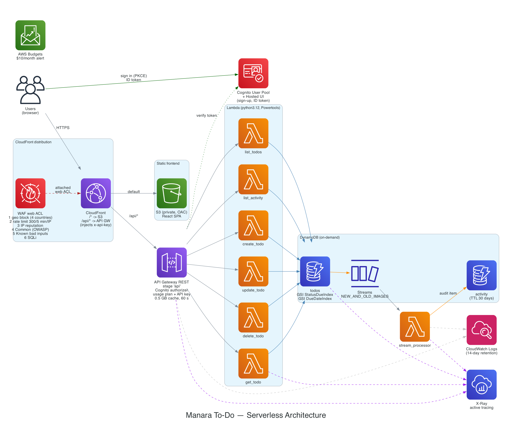
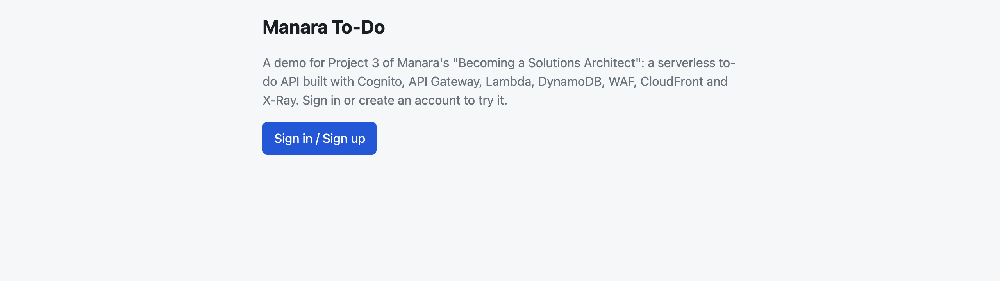
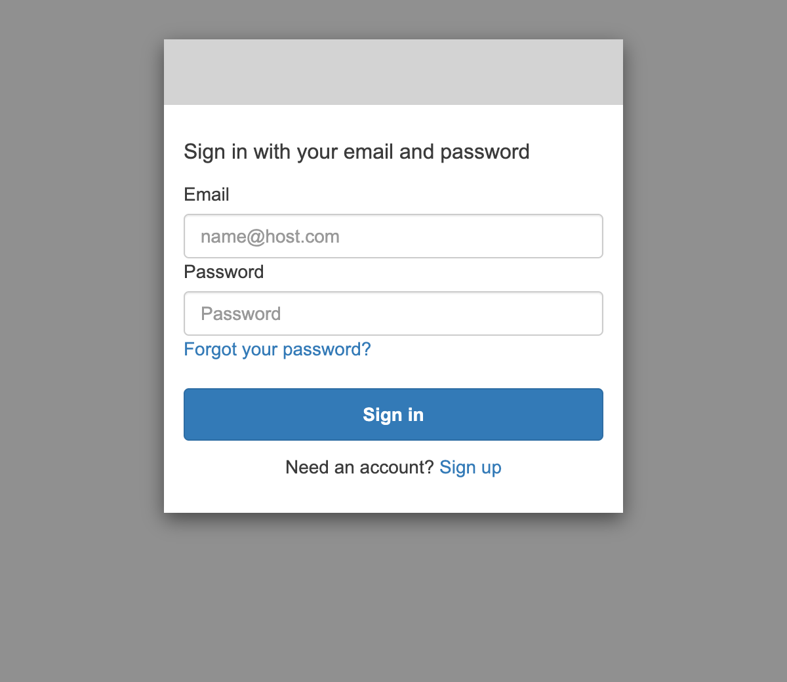
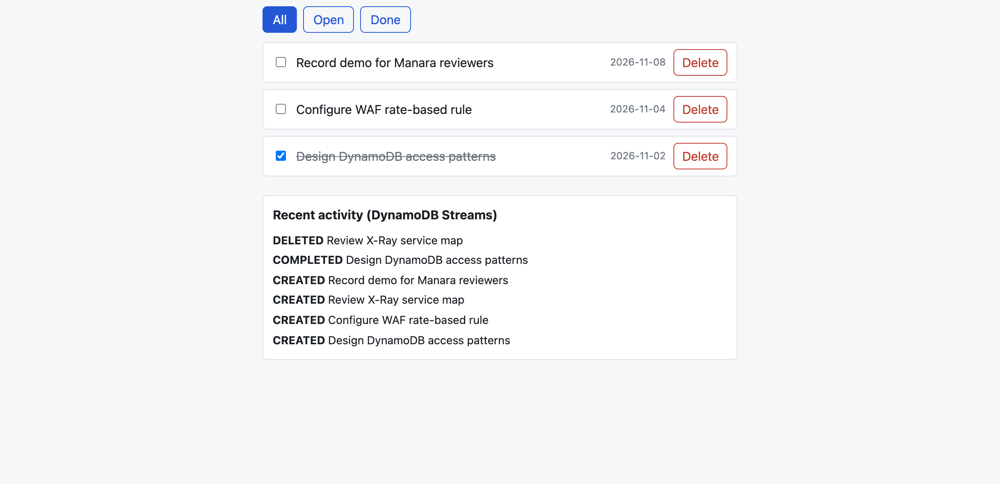
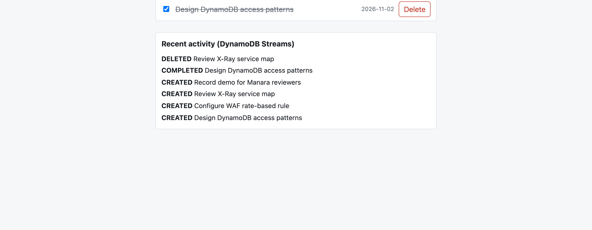
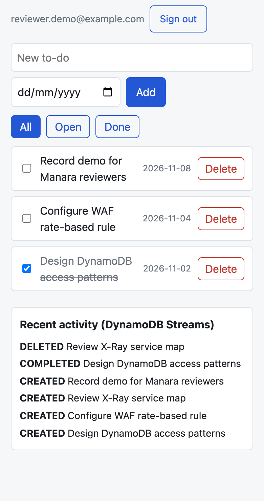

# Manara To-Do: Serverless REST API with Cognito, DynamoDB and WAF

A per-user to-do app built for the Manara "Becoming a Solutions Architect" Project 3. It runs entirely on AWS serverless services and is deployed with Terraform.

[](https://github.com/mustafa-premiera/api/actions/workflows/ci.yml)
[](https://github.com/mustafa-premiera/api/actions/workflows/deploy.yml)

**Live app:** https://do5ec8al4bb0z.cloudfront.net/



Source for the diagram: [`docs/architecture/diagram.py`](docs/architecture/diagram.py) (Python `diagrams` library).

## Review in 5 minutes

1. Open the live app URL above (region `us-east-1`).
2. Click **Sign in**. You are redirected to the Cognito Hosted UI (`https://manara-todo-wc1huz.auth.us-east-1.amazoncognito.com`). Choose **Sign up**, enter any email and a password (8+ characters, upper and lower case, a digit).
3. Cognito emails you a verification code. It comes from `no-reply@verificationemail.com` and may land in spam; Cognito's default sender is limited to about 50 emails per day. Enter the code, then sign in.
4. Add a to-do (optionally with a due date), mark it done, edit it, then delete it.
5. Watch **Recent activity (DynamoDB Streams)** on the page. Each change appears there a moment later. It is written by a separate Lambda that consumes the table's stream, so seeing it proves Streams works end to end.
6. Sign up a second user in a private window. It sees an empty list: each user only ever sees their own items, including through the API cache.

Direct calls to the API Gateway URL (`https://wlolz7mdl1.execute-api.us-east-1.amazonaws.com/api`) are rejected unless they carry both a valid ID token and the API key. The key is only known to CloudFront, so use the CloudFront URL (see the status codes under API Gateway below).

## Screenshots

Taken from the app running against the deployed backend (Cognito, API Gateway, Lambda, DynamoDB and Streams), signed in as a demo user.

| Signed out | Cognito Hosted UI |
|---|---|
|  |  |

**Signed in.** Three to-dos, one completed. The activity panel is filled by the DynamoDB Streams processor: the CREATED, COMPLETED and DELETED entries each appear a few seconds after the change.



| Filter: Done (served by the `StatusDueIndex` GSI) | Phone width |
|---|---|
|  |  |

## Request path

1. The browser requests the CloudFront URL. The **WAF** web ACL attached to the distribution inspects every request first.
2. The default behavior serves the React SPA from a private **S3** bucket (Origin Access Control). `config.json` in the bucket tells the SPA the Cognito settings.
3. The SPA signs the user in with the Cognito **Hosted UI** (authorization code flow with PKCE) and receives an **ID token**.
4. The SPA calls `/api/...` with the ID token in the `Authorization` header. The `/api/*` behavior forwards to **API Gateway** with caching disabled at CloudFront, and adds the secret `x-api-key` header.
5. API Gateway (REST, stage `api`) validates the token with the **Cognito authorizer**, checks the API key and usage plan, and serves GET responses from its **0.5 GB cache** when possible.
6. On a cache miss it invokes one of six **Lambda** functions. The user id is the token's `sub` claim.
7. The function reads or writes the **DynamoDB** `manara-todo-todos` table.
8. Every change to that table is published to **DynamoDB Streams**. The `stream_processor` Lambda writes one audit item per change to `manara-todo-activity`, which `GET /api/activity` returns.
9. **X-Ray** traces API Gateway, Lambda and DynamoDB. Logs go to **CloudWatch**. An **AWS Budget** watches cost.

API routes (all require a Cognito token and the API key):

| Route | Lambda |
|---|---|
| `GET /api/todos?status=OPEN\|DONE` | `manara-todo-list_todos` |
| `POST /api/todos` | `manara-todo-create_todo` |
| `GET /api/todos/{id}` | `manara-todo-get_todo` |
| `PUT /api/todos/{id}` | `manara-todo-update_todo` |
| `DELETE /api/todos/{id}` | `manara-todo-delete_todo` |
| `GET /api/activity` | `manara-todo-list_activity` |

## Services and how to verify each

Evidence from the deployed app is saved under `docs/evidence/`. Run `scripts/smoke_test.py` to repeat the end-to-end test (it creates two temporary Cognito users through the `smoke` app client, calls every route through CloudFront, checks isolation between the two users, and deletes the users and their data afterwards) and `scripts/waf_rate_test.sh` to trigger the WAF rate limit. Use `AWS_PROFILE` for your own profile in the commands below.

### CloudFront
- One distribution, two origins. Default behavior: S3 (`Managed-CachingOptimized`). `/api/*`: API Gateway with `Managed-CachingDisabled`, all methods allowed, viewer headers forwarded. HTTPS only (HTTP redirects). Price class 100.
- The `/api/*` origin sends the custom header `x-api-key`.
- Verify: Console, CloudFront, Distributions, Behaviors and Origins tabs. Or `aws cloudfront get-distribution --id $(terraform -chdir=infra output -raw distribution_id)`.

### S3
- Private bucket `manara-todo-frontend-<account>`, all public access blocked, bucket policy allows only this CloudFront distribution through Origin Access Control.
- Verify: Console, S3, the bucket, Permissions. Requesting an object by its S3 URL returns 403; through CloudFront it works.

### WAF
Web ACL `manara-todo-cloudfront`, scope CLOUDFRONT, default action allow. Rules in evaluation order:

| Priority | Rule | Action |
|---|---|---|
| 0 | `geo-block`: countries KP, CU, IR, SY | block |
| 1 | `rate-limit-api`: 300 requests per 5 minutes per IP, only for paths starting `/api/` | block with custom 429 JSON `{"message":"Too many requests"}` |
| 2 | `AWSManagedRulesAmazonIpReputationList` | managed (bot and threat IPs) |
| 3 | `AWSManagedRulesCommonRuleSet` (OWASP Top 10 style protections) | managed |
| 4 | `AWSManagedRulesKnownBadInputsRuleSet` | managed |
| 5 | `AWSManagedRulesSQLiRuleSet` | managed |

Bot Control is not enabled because it costs about $10/month extra; the IP reputation and known-bad-inputs groups cover the basic bot and malicious-client case.

Verify: Console, WAF & Shield, Web ACLs (scope: Global/CloudFront), `manara-todo-cloudfront`, Rules and the sampled-requests view. Run `scripts/waf_rate_test.sh` and compare with `docs/evidence/waf_rate_test.txt`: WAF evaluates the rate with a 30–60 s lag, so the first burst may still pass and a second burst a minute later returns 429. Afterwards your IP stays blocked on `/api/` for up to 5 minutes.

### API Gateway
- REST API `manara-todo`, regional, stage `api`, so CloudFront `/api/todos` maps straight to the stage.
- Cognito User Pools authorizer on every method; every method requires an API key.
- Usage plan `manara-todo-cloudfront`: 20 requests/s rate, 40 burst, 10,000 requests/day quota. Method throttling is the same 20/40.
- Cache cluster 0.5 GB, TTL 60 s, on `GET /todos` and `GET /todos/{id}`. The cache key includes the `Authorization` header, and `status` / `v` (or `id`) parameters.
- X-Ray tracing and JSON access logs (including `xrayTraceId` and the user's `sub`) are on, retained 14 days.
- Verify: Console, API Gateway, `manara-todo`, Stages, `api` (Settings shows the cache and X-Ray), Authorizers, Usage Plans. Direct calls to the `execute-api` URL behave as follows (measured on the live API):

  | Token | API key | Result |
  |---|---|---|
  | none | none | 401 (the Cognito authorizer runs first) |
  | none | yes | 401 |
  | valid ID token | none | 403 Forbidden |
  | valid ID token | yes | 200 |

  To see the 403, sign in to the app, copy the `id_token` from the browser's sessionStorage (DevTools, Application, Session Storage, key starting `oidc.user:`), then run `curl -i -H "Authorization: <id_token>" https://wlolz7mdl1.execute-api.us-east-1.amazonaws.com/api/todos`. The key itself is never exposed to browsers; only CloudFront can add it.

### Cognito
- User pool `manara-todo`: email is the username, self sign-up on, email verified with a code (Cognito default sender), password minimum 8 with upper case, lower case and digit.
- Hosted UI domain `https://manara-todo-wc1huz.auth.us-east-1.amazoncognito.com`.
- App client `manara-todo-web`: public (no secret), authorization code flow with PKCE, scopes `openid email profile`, callback and logout URL is the CloudFront URL (plus `http://localhost:5173/` for local development).
- A second client, `manara-todo-smoke`, only allows `ADMIN_USER_PASSWORD_AUTH`, used by the scripted test.
- Verify: Console, Cognito, User pools, `manara-todo`, App integration. After signing up, the user appears under Users.

### Lambda
- Six API functions plus `stream_processor`, all `python3.12`, 256 MB, 10 s timeout, from one code package (`backend/src/todo_app`), with the AWS Lambda Powertools v3 public layer (structured logging and X-Ray tracer).
- Environment variables: `TODOS_TABLE`, `ACTIVITY_TABLE`, `POWERTOOLS_SERVICE_NAME`.
- Active X-Ray tracing on every function. Log retention 14 days.
- Least-privilege IAM roles (below).
- Verify: Console, Lambda, Functions, filter `manara-todo`; Configuration tab for environment variables, role and tracing.

| Role | Used by | DynamoDB permissions |
|---|---|---|
| read | `list_todos`, `get_todo`, `list_activity` | `Query`, `GetItem` on todos and its indexes; `Query` on activity |
| write | `create_todo`, `update_todo`, `delete_todo` | `GetItem`, `PutItem`, `UpdateItem`, `DeleteItem` on todos only |
| stream | `stream_processor` | read the todos stream; `PutItem` on activity |

All roles also have basic logging and X-Ray write permissions.

### DynamoDB
- `manara-todo-todos`, on-demand, point-in-time recovery, Streams `NEW_AND_OLD_IMAGES`. Key: `userId` (Cognito `sub`) + `todoId` (UUID).
- `manara-todo-activity`, on-demand. Key: `userId` + `sk` (`<ISO timestamp>#<eventId>`), TTL attribute `ttl` (30 days). Actions recorded: `CREATED`, `UPDATED`, `COMPLETED`, `DELETED`.
- Verify: Console, DynamoDB, Tables, the table, Indexes and Exports and streams tabs; Explore items to see the data.

Access patterns:

| Pattern | Table / index | Key condition |
|---|---|---|
| Get one to-do | `todos` | `userId = :sub AND todoId = :id` (GetItem) |
| All my to-dos | `todos` | `userId = :sub` |
| My OPEN or DONE to-dos, ordered by due date | `todos` / `StatusDueIndex` | `userId = :sub AND begins_with(statusDue, "OPEN#")` (or `DONE#`). `statusDue` is `<status>#<dueDate or 9999-12-31>` |
| Everything due on a given day (for a future reminder job) | `todos` / `DueDateIndex` | `dueDate = :day`. Keys-only, sparse (only items with a due date) |
| My recent activity | `activity` | `userId = :sub` |
| Expire old audit items | `activity` | TTL on `ttl` |

### DynamoDB Streams
- Enabled on `todos`; the `stream_processor` Lambda is the consumer and writes to `activity`. Reviewers see the result live in "Recent activity".
- Verify: Console, DynamoDB, `manara-todo-todos`, Exports and streams; Lambda, `manara-todo-stream_processor`, Configuration, Triggers.

### X-Ray
- Active tracing on the API Gateway stage and all Lambda functions; Powertools instruments the DynamoDB calls.
- Verify: Console, CloudWatch, Application Signals / X-Ray traces, Trace map, or `docs/evidence/xray_traces.json`.

### CloudWatch and Budgets
- Log groups `/aws/lambda/manara-todo-*` and `/aws/apigateway/manara-todo-access`, 14-day retention. WAF metrics are enabled for every rule.
- Budget `manara-todo-monthly`: $10 per month, emails at 50% and 100% of actual spend.
- Verify: Console, CloudWatch, Log groups; Billing, Budgets.

## CI/CD

GitHub Actions checks every pull request and deploys `main` with Terraform. No AWS keys are stored in GitHub: workflows assume IAM roles through OIDC.

**Pull request** (`.github/workflows/ci.yml`):
1. Checks run first (shared `checks.yml`): backend `pytest`, frontend build, `terraform fmt -check` and `validate` for `infra/` and `bootstrap/`.
2. The `plan` job assumes the plan role, runs `terraform plan -lock=false` against the remote state, and posts the plan as a single PR comment (updated on each push). It is skipped for PRs from forks.

**Push to `main`** (`.github/workflows/deploy.yml`, also runnable by hand):
1. The same checks run.
2. The `deploy` job assumes the deploy role and verifies the remote state object exists.
3. `terraform apply -auto-approve` updates the infrastructure.
4. `scripts/deploy_frontend.sh` builds the SPA, syncs it to S3 and invalidates CloudFront. The app URL is written to the job summary.

Deploys are serialized (`concurrency: deploy-main`, never cancelled mid-apply).

### OIDC roles

| Role | Trusted subject | Permissions |
|---|---|---|
| `arn:aws:iam::<account-id>:role/manara-todo-gha-plan` | `repo:mustafa-premiera@343404294/api@1428567674:pull_request` (and the legacy `repo:mustafa-premiera/api:pull_request`) | `ReadOnlyAccess` plus read (`s3:GetObject`, `s3:ListBucket`) on the state bucket |
| `arn:aws:iam::<account-id>:role/manara-todo-gha-deploy` | `repo:mustafa-premiera@343404294/api@1428567674:ref:refs/heads/main` (and the legacy `repo:mustafa-premiera/api:ref:refs/heads/main`) | `AdministratorAccess` |

Both require the audience `sts.amazonaws.com`. The deploy role is `AdministratorAccess` because Terraform manages IAM roles, WAF, CloudFront, API Gateway and more; the safety comes from the trust policy (only workflows running on `main` can assume it) and the provider's account guard, which refuses any other account. The plan role cannot write state or locks, which is why PR plans use `-lock=false`.

Terraform state lives in `s3://manara-todo-tfstate-<account-id>/infra/terraform.tfstate` with native S3 locking (`use_lockfile`, no DynamoDB table).

### Repository variables and secrets

Set the variables under Settings, Secrets and variables, Actions, Variables, and `ALERT_EMAIL` under the Secrets tab (a secret so the address is masked and never appears in public PR plan comments). `ENABLE_WAF` and `ENABLE_API_CACHE` must be exactly `true` or `false` when set.

| Variable | Purpose |
|---|---|
| `AWS_PLAN_ROLE_ARN` | ARN of `manara-todo-gha-plan` |
| `AWS_DEPLOY_ROLE_ARN` | ARN of `manara-todo-gha-deploy` |
| `ALERT_EMAIL` (secret) | Budget alert address (`alert_email`); required, the workflows fail if unset |
| `ENABLE_WAF` | `true` or `false` (`enable_waf`); defaults to `false` in CI when unset |
| `ENABLE_API_CACHE` | `true` or `false` (`enable_api_cache`); defaults to `false` in CI when unset |

The PR plan reflects only these repository variables, the `ALERT_EMAIL` secret and the defaults, not your local `terraform.tfvars`, so it can differ from what you see running `plan` locally. Note that the deploy applies the same values: with `ENABLE_WAF` and `ENABLE_API_CACHE` unset, CI deploys without WAF and the cache.

### One-time bootstrap

The `bootstrap/` stack creates the state bucket, the GitHub OIDC provider and the two roles. It uses local state (`bootstrap/terraform.tfstate`, gitignored) and is run once by hand:

```bash
export AWS_PROFILE=<your-profile>
terraform -chdir=bootstrap init && terraform -chdir=bootstrap apply
```

Then point `infra/` at the remote state. With an existing local state, migrate it; on a fresh checkout just init:

```bash
terraform -chdir=infra init -migrate-state   # existing local state
terraform -chdir=infra init                  # fresh
```

Finally set the repository variables above from the bootstrap outputs.

### Branch protection

Recommended: Settings, Branches, add a rule for `main` that requires a pull request and the status checks from the `checks` jobs (`checks / backend-tests`, `checks / frontend-build`, `checks / terraform-static`) before merging.

## Security notes

- **ID token, not access token.** The Cognito User Pools authorizer validates ID tokens directly and puts the verified claims (including `sub`) in the request context. Access tokens only work with the authorizer when scopes are configured, and carry no email claims. The Lambda trusts `requestContext.authorizer.claims.sub` and never a client-supplied user id.
- **Per-user isolation, including the cache.** Every DynamoDB query is keyed on the caller's `sub`. The API Gateway cache key includes the `Authorization` header, so two users never share a cached response. The frontend adds a `v` query parameter that it bumps after each write, so a user sees their own change immediately without invalidating the cache.
- **API key known only to CloudFront.** All methods require an API key and the key is injected by CloudFront as an origin header, so the browser never sees it. Even a user with a valid ID token who calls the `execute-api` URL directly gets 403 Forbidden (and 401 without a token), because only CloudFront holds the key. That forces all traffic through CloudFront and therefore through WAF.
- **Least-privilege IAM.** Separate read, write and stream roles, each scoped to specific tables and actions (see above).
- **Private S3.** Public access is blocked and only this CloudFront distribution can read the bucket (OAC).
- **Secrets.** No secrets in the repo. `terraform.tfvars` and the local bootstrap state are gitignored; the infra state lives in the private S3 state bucket.

## Cost

| Item | Cost | Switch |
|---|---|---|
| WAF | about $5/month for the web ACL, +$1/month per rule and per managed group (6 rules, about $11 total), +$0.60 per million requests | `enable_waf` |
| API Gateway cache (0.5 GB) | about $0.02/hour, about $14.60/month | `enable_api_cache` |
| CloudFront, S3, API Gateway requests, Lambda, DynamoDB on-demand, Cognito, CloudWatch, X-Ray | about $0 at review traffic (within free tiers or pennies) | none |
| Budgets | free (first budgets) | none |

WAF and the cache dominate the bill. To run cheaply, set these in `infra/terraform.tfvars` and run `terraform -chdir=infra apply`:

```hcl
enable_waf       = false
enable_api_cache = false
```

Both default to `true`. With both on, the expected steady-state cost is about $25–26/month (WAF web ACL $5 + 6 rules/groups × $1 + requests, plus the API cache at about $14.60/month); everything else is about $0 at review traffic. The $10/month budget alert will therefore fire at 50% after roughly 6 days and at 100% after roughly 12 days. After grading, set `enable_waf` and `enable_api_cache` to `false` (the `ENABLE_WAF` / `ENABLE_API_CACHE` repository variables if you deploy through CI) or run `terraform -chdir=infra destroy` to stop the charges.

## Deploy

Pushes to `main` deploy automatically (see CI/CD above). To deploy from your machine:

Prerequisites: Terraform 1.10+, AWS CLI v2 (logged in to the target account), Node 20+, Python 3.12.

```bash
export AWS_PROFILE=<your-profile>
cp infra/terraform.tfvars.example infra/terraform.tfvars   # set alert_email
terraform -chdir=infra init
terraform -chdir=infra apply
./scripts/deploy_frontend.sh      # builds the SPA, syncs to S3, invalidates CloudFront
terraform -chdir=infra output app_url
```

State is stored remotely in S3 (see the bootstrap steps above for the first-time setup). `deploy_frontend.sh` honors `AWS_PROFILE` (default `manara-free`) outside GitHub Actions.

Destroy everything: `terraform -chdir=infra destroy`.

## Local development

```bash
API_KEY=$(terraform -chdir=infra output -raw api_key_value) npm --prefix frontend run dev
```

The dev server runs on http://localhost:5173/ (an allowed Cognito callback) and proxies `/api` to API Gateway with the key attached.

## Testing

```bash
cd backend && .venv/bin/pytest
```

Create the venv first with `python3.12 -m venv backend/.venv && backend/.venv/bin/pip install -r backend/requirements-dev.txt`. To regenerate the diagram: `brew install graphviz && python3.12 -m venv docs/architecture/.venv && docs/architecture/.venv/bin/pip install -r docs/architecture/requirements.txt && docs/architecture/.venv/bin/python docs/architecture/diagram.py` (the venv is gitignored).

## Repo layout

```
.
├── backend/
│   ├── src/todo_app/       # Lambda code: handlers/, repository, models, stream translation
│   └── tests/              # pytest unit tests (moto)
├── frontend/               # Vite + React SPA (Cognito Hosted UI via react-oidc-context)
├── .github/workflows/      # ci.yml (PR), deploy.yml (main), checks.yml (shared)
├── bootstrap/              # Terraform state bucket + GitHub OIDC roles (run once)
├── infra/                  # Terraform: apigateway, cloudfront, cognito, dynamodb, iam, lambda, waf, budget, frontend
├── scripts/                # deploy_frontend.sh, smoke_test.py, waf_rate_test.sh
├── docs/
│   ├── architecture/       # diagram source and PNG
│   └── evidence/           # saved test output and X-Ray traces
└── LICENSE
```
